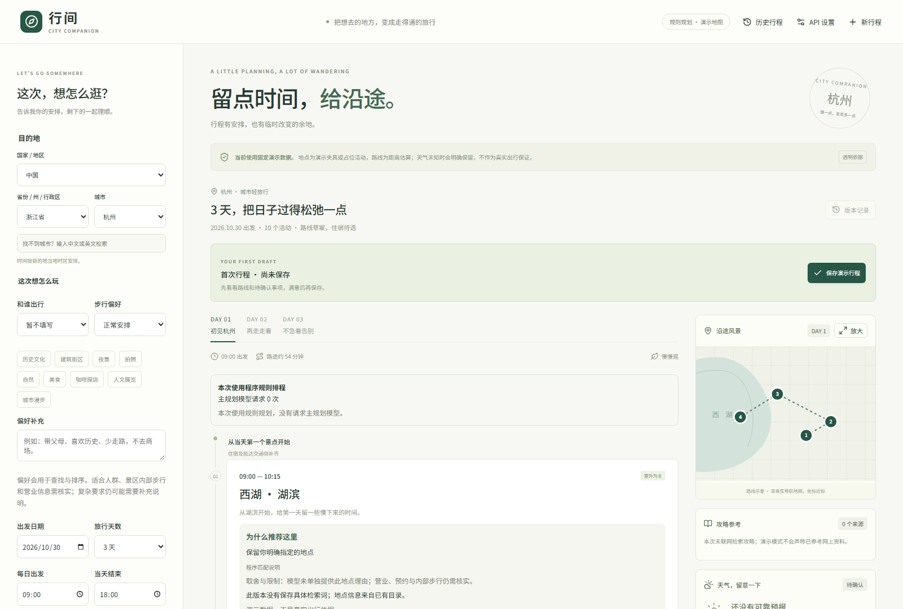
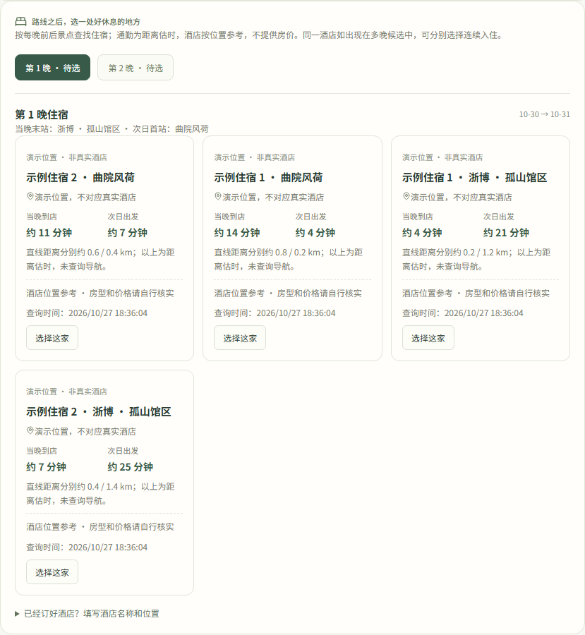
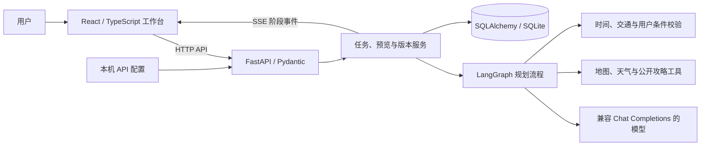
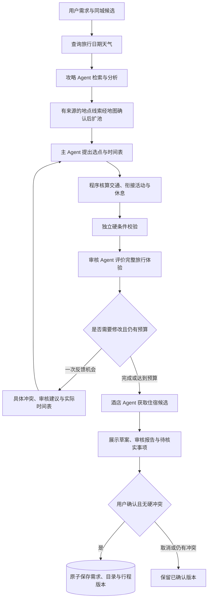

# 行间 · 城市旅行 Agent

**把想去的地方，变成走得通、改得动的行程。**

面向 1～3 天城市自由行的多 Agent 旅行规划工作台。结合用户偏好、公开攻略、地图路线和逐日天气，生成带具体时间安排的行程；当出发时间、想去的地点或住宿变化时，先展示调整预览，再由用户确认保存。

`Python` · `FastAPI` · `LangGraph` · `LLM Tool Calling` · `React` · `TypeScript` · `SQLAlchemy`

> 当前为可本地运行的开发版。无需 API Key 即可体验规则演示；接入自己的模型和高德 Key 后可使用模型规划与真实地图查询。演示地点、时间与坐标为夹具，路线为估算，天气保持未知。



[为什么做](#为什么做这个项目) · [项目特色](#项目特色) · [页面展示](#页面展示) · [整体结构](#项目整体结构) · [Agent 架构](#agent-架构) · [快速开始](#快速开始) · [测试与评测](#测试与评测)

## 为什么做这个项目

让大模型列出几个景点并不难，但一份旅行计划还需要回答：

- 景点之间来得及赶到吗？预约、入住和返程时间会不会冲突？
- 推荐理由中的夜景、休息和天气取舍，是否真正落实到了时间表？
- 已经订好的酒店和固定预约，能否在修改计划时继续保留？
- 模型、地图和攻略各自提供了什么依据？哪些信息还没有核实？

这个项目尝试把旅行规划做成一个可检查、可修改、可追溯的工作流：**模型提出安排、比较旅行体验，程序核算时间与交通、保护用户明确条件，用户决定是否采用。**

## 项目特色

| 特色 | 当前实现 |
| --- | --- |
| **多 Agent 分工** | 攻略、主规划、独立审核和酒店四类角色，使用独立上下文或结构化交接，保留任务输入、状态和结果。 |
| **需求驱动候选** | 根据主题、同行人和步行偏好检索同城 POI；攻略提出的新地点须经有限地图查询确认，不能由模型编造坐标。 |
| **具体时间表与天气** | 主模型可提出逐日活动起止时间、用餐休息和天气取舍；程序查询逐段交通，处理时间衔接并独立校验。 |
| **规划与审核分离** | 审核 Agent 逐天评价节奏、留白、天气和推荐一致性；模型判断不能豁免预约、交通或时间冲突。 |
| **自然语言调整** | 支持增删、跨日移动、延迟出发和时段修改，最多 3 轮冲突反馈协调，保留用户酒店、锁定活动及指定日期。 |
| **路线优先选住宿** | 按当日末站和次日首站推荐酒店位置，选择后补齐相邻两天交通，生成待确认调整。 |
| **可追溯的版本管理** | 预览与确认分离，支持幂等提交、并发版本检查、历史行程和版本恢复；需求、地点目录与行程一起保存。 |
| **有界外部调用** | 模型工具允许列表与调用预算，高德按 Key 串行限流、缓存和有限退避；失败、降级与待核实信息明确展示。 |

## 页面展示

以下截图均由实际前端在**隔离的规则演示模式**下生成，不包含私人行程或 API Key，也不用于证明真实地图和模型查询结果。

### 路线规划与住宿候选

桌面工作台将旅行条件、分日时间轴、地图、攻略和检查结果放在同一页面。路线草案确认后，可按夜晚比较住宿候选与前后通勤估时。



### 修改说明与历史版本

例如输入“第 1 天晚出发 5 分钟”，先查看实际变化，再确认保存。历史恢复会创建新版本，保留已有记录。

| 调整说明 | 版本记录 |
| --- | --- |
|  |  |

### 移动端

支持折叠旅行条件、切换日期与查看活动卡片；地图可放大查看。


截图可复现：完成依赖安装和 Chromium 安装后，在仓库根目录运行 `node scripts/capture_readme.mjs`。脚本使用独立的临时数据库、空配置和端口 `8012 / 5182`，结束后关闭所启动的服务。

## 项目整体结构



前端负责条件编辑、行程展示和确认交互；后端负责 Agent 调用、工具适配、排程校验与版本事务。任务目前运行在 API 进程内，任务结果与阶段事件持久化，SSE 支持按游标回放。

```text
city-trip-agent/
├── backend/
│   ├── app/
│   │   ├── main.py                       # FastAPI 路由与生命周期
│   │   ├── agent.py                      # LangGraph 阶段编排
│   │   ├── guide_agent.py / review_agent.py / hotel_agent.py
│   │   ├── candidate_discovery.py / candidate_ranking.py
│   │   ├── guide_discovery.py             # 攻略地点线索的地图确认
│   │   ├── llm.py / planning_output.py    # 工具调用、结构化输出与纠正
│   │   ├── planner.py / timed_planning.py # 规则排程、模型时间表与交通衔接
│   │   ├── revisions.py / replanning.py  # 自然语言修改与有界协调
│   │   ├── validation.py                 # 独立硬条件检查
│   │   ├── tools.py / amap_gateway.py    # Provider、限流、缓存与重试
│   │   ├── agent_tasks.py / services.py  # 任务记录、预览与确认事务
│   │   └── schemas.py / database.py      # 数据契约与持久化
│   ├── migrations/                      # Alembic 数据库迁移
│   └── tests/                           # 后端回归测试
├── frontend/
│   ├── src/                             # 条件、时间轴、地图、住宿与历史交互
│   └── e2e/                             # Playwright 桌面与移动端流程
├── data/curated/                         # 演示地点夹具
├── data/geography/                       # 固定版本地理目录与许可
├── evals/datasets/                       # 排程冒烟及合成质量样例
├── scripts/                              # 安装、启动、评测与 README 截图
└── docs/                                 # 设计说明、开发指南与页面截图
```

## Agent 架构

### 角色与职责

| 角色 | 主要输入 | 输出与边界 |
| --- | --- | --- |
| **攻略 Agent** | 旅行需求、搜索结果及公开页面片段 | 带来源 ID 的结构化结论、待核实事项和地点线索。原始网页保留在研究任务中，不直接塞入主 Agent 上下文。 |
| **主 Agent** | 用户条件、已准入候选、攻略结论、逐日天气与反馈 | 选点、分天、具体时间表、用餐休息和推荐理由。兼容仅返回地点顺序的模型输出，并明确标记程序排程。 |
| **审核 Agent** | 完整时间表、实际交通、天气、用户偏好及推荐依据 | 逐日体验报告、问题与建议；与主 Agent 使用独立上下文，不能将硬冲突判为通过。 |
| **酒店 Agent** | 每晚末站、次日首站及地图酒店候选 | 住宿位置比较与排序，选择由用户完成；不提供房价、房型或库存。 |

### 首次生成流程



LangGraph 的顶层节点为 `weather → research → main → hotels`。主规划阶段内部执行排程、硬校验、独立体验审核和有界反馈；当前按阶段串行执行，没有分布式 Agent 调度或无限自主循环。

### 几个关键设计

- **把体验判断与可执行性检查分开。** 是否重访、活动多少、是否保留休息由模型综合判断；时间重叠、交通接不上、锁定预约变化、明确必去和指定日期不满足等由程序独立检查。未知营业时间保留为提醒，不当成已确认的闭馆条件。
- **把事实、估算和建议分开记录。** 地点和交通关联 Provider、来源及查询时间；模型的室内外判断、推荐理由和估算停留时长不能冒充已核实事实。
- **把修复做成有限闭环。** 首次生成最多一次主规划反馈；自然语言调整最多 3 轮协调。结构化输出错误反馈具体字段，纠正继续消耗既有模型请求和时间预算。
- **把变更做成待确认事务。** 新增地点、修改需求和新行程先属于预览；确认时一起保存，取消不会修改当前版本，历史恢复同时恢复对应需求和地点证据。
- **给外部调用设置边界。** 每次主模型工具循环最多 4 轮请求、6 次不同目录查询；重复查询复用缓存。高德同 Key 在当前进程内串行限流，QPS 错误有限退避，认证或日额度错误明确返回。

当前硬条件与体验判断的完整划分见 [约束政策](docs/CONSTRAINT_POLICY.md)。

## 快速开始

### 环境要求

- Python **3.12+**
- Node.js **22.12+ 或 24+**
- 首次安装需要网络；默认演示不需要模型或地图 Key。

### Windows PowerShell

```powershell
git clone https://github.com/qzk333/city-trip-agent.git
Set-Location city-trip-agent
.\scripts\setup.ps1
.\scripts\dev.ps1
```

安装脚本创建后端虚拟环境、安装锁定依赖并执行迁移；启动脚本运行前后端服务，按 `Ctrl+C` 关闭。也可通过 `setup.ps1 -Python <python.exe路径>` 指定解释器。

- 前端：[http://127.0.0.1:5173](http://127.0.0.1:5173)
- API 文档：[http://127.0.0.1:8000/docs](http://127.0.0.1:8000/docs)

macOS / Linux 可分别创建 `backend/.venv`、安装 `backend/requirements.lock` 和本地后端包，在 `frontend` 运行 `npm ci`；随后分别用 Uvicorn 与 `npm run dev` 启动。具体命令见[开发指南](docs/LOCAL_DEVELOPMENT.md)。

### 建议体验路径

1. 保留杭州演示目的地，选择旅行天数，勾选固定预约，生成行程。
2. 查看分日时间轴、路线示意和行程检查，确认保存演示行程。
3. 输入“第 1 天晚出发 5 分钟”，比较调整说明与预约是否保留，再确认或取消。
4. 多日行程可按夜晚选择住宿，查看接驳变化；刷新页面验证保存结果。
5. 打开版本记录恢复旧安排，或从首页“历史行程”重新打开旅行。
6. 新建行程，将当天结束改为 `09:10`，观察必去地点无法排入时如何阻止保存。

### 接入真实模型与地图

在页面右上角“API 设置”填写自己的服务信息：

| 配置 | 用途 |
| --- | --- |
| 模型 HTTPS 地址、模型 ID、API Key | 兼容 Chat Completions，并支持工具调用与 JSON 输出的模型服务。 |
| 高德 **Web 服务 Key** | 查询中国大陆真实 POI、路线和天气。填写后先查询当前城市真实地点，再生成行程。 |
| 高德 **JS API Key + 安全密钥**（可选） | 显示交互地图；未配置时保留明确标注的路线示意。 |

配置保存在被 Git 忽略的 `.local/api-config.json`，本机明文保存，便于个人开发；凭据不写入行程或数据库。远程请求不会继承本机配置，网页不继承 `.env` 的 Key。本地多用户认证与公开部署隔离尚未实现。

详细的模型兼容、连接测试、配置迁移、API 预算和地图 Key 说明见[本地运行与服务配置](docs/LOCAL_DEVELOPMENT.md)。地理目录覆盖全球，但当前真实地图适配器仅支持中国大陆；境外目录可用于示意体验。

## 测试与评测

在仓库根目录执行后端检查和离线评测：

```powershell
& backend/.venv/Scripts/python.exe -m pytest backend/tests -q
& backend/.venv/Scripts/python.exe -m ruff check backend/app backend/tests backend/migrations scripts
& backend/.venv/Scripts/python.exe scripts/evaluate.py
& backend/.venv/Scripts/python.exe scripts/evaluate_quality.py
```

前端检查：

```powershell
Set-Location frontend
npm run format:check
npm run build
npx playwright install chromium
npm run test:e2e
```

浏览器回归自动启动独立的后端 `8001`、前端 `5174`，使用演示 Provider、独立数据库和 `.local/e2e-api-config.json`。已有同端口服务需先关闭。

本地验证（2026-10-27）：

| 检查 | 结果 | 范围 |
| --- | --- | --- |
| Pytest | **332 项通过** | 排程、工具协议、地图网关、约束边界、审核、修改、数据库迁移和版本事务。 |
| Playwright | **70 条通过** | 桌面与移动端的生成、保存、调整、取消、恢复、设置及历史行程。 |
| Ruff / Prettier / 生产构建 | **通过** | 后端静态检查、前端格式检查、TypeScript 与 Vite 构建。 |
| 基础冒烟集 | **10 / 10** | 验证正常、冲突、时间不足及工具预算等预期状态。 |
| 合成质量集 | **30 / 30 预期结果通过** | 比较候选排序与空间排程；不衡量在线搜索召回率或真实旅游成功率。 |

离线结果写入被忽略的 `evals/results/`。模型协议回归主要使用模拟响应，真实调用记录另见 `evals/reports/`；不将开发集通过数当作真实用户效果。仓库提供 [GitHub Actions 检查流程](.github/workflows/ci.yml)。

## 当前边界与后续方向

- 地点营业、闭馆日、预约、内部步行及停留时间仍需核实；公开攻略与模型判断是参考。
- 酒店仅提供位置建议，没有预订、房价和库存服务；不查询航班或铁路班次，不支持跨夜接驳。
- 首次规划的自由自主补查、多轮对话澄清、完整事实核验和真实途中“已完成活动”管理尚未完成。
- 默认数据库为 SQLite；PostgreSQL 配置入口已保留，尚未完成真实集成验证。
- 后台任务在 API 进程内执行，重启会标记中断，尚无自动续跑、独立 worker 或持久化图检查点。
- 限流和缓存作用于当前进程，不是分布式限流；排程不承诺全局最优。

下一步优先完善事实核验、多轮澄清、真实出行 Badcase 评测及任务恢复。

## 进一步阅读

- [本地运行、模型与地图配置、迁移说明](docs/LOCAL_DEVELOPMENT.md)
- [当前约束政策：程序校验与模型判断的边界](docs/CONSTRAINT_POLICY.md)
- [独立审核 Agent 的输入、报告与反馈闭环](docs/INDEPENDENT_SCHEDULE_REVIEW.md)
- [攻略扩充候选与活动时间链](docs/GUIDE_EXPANSION_AND_TIME_CHAIN.md)
- [模型输出纠正与修改失败展示](docs/PLANNING_OUTPUT_RECOVERY.md)
- [自然语言目标修改与重规划设计](docs/decisions/0003-goal-based-replanning.md)
- [实现状态与历次验证记录](docs/IMPLEMENTATION_STATUS.md)
- [多 Agent 初始实现记录](docs/MULTI_AGENT_IMPLEMENTATION.md)
- [后续改进方案](docs/IMPROVEMENT_PLAN.md)
- [地理目录来源与数据许可](data/geography/ATTRIBUTION.md)
