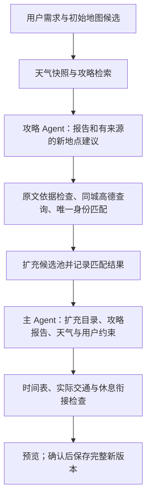

# 攻略扩充候选池与连锁时间修复

日期：2026-10-26。此前暂缓的首次补查，本轮按用户新要求启用**攻略线索驱动的有限地图确认**；不是让主模型自由无限检索。

## 规划流程

攻略分析可输出最多 6 条 `place_suggestions`，包含 name、category、reason、source_ids，提示模型优先给两三个目录缺少且有价值的地点。主模型收到的报告增加 `place_resolutions`，区分 existing、added、ambiguous、no_result、unsupported、excluded、skipped 和 unavailable。

程序确认流程：

1. 引用必须存在，且地名实际出现在引用的标题/片段中；模型常识或自己的摘要不能充当原文依据。
2. 已有同名唯一地点复用稳定 ID；同名多个不替用户猜。
3. 每次最多 3 次关键词地图查询，每次最多 3 条返回，沿用当前城市限制、坐标/类型检查和共享限流网关；时间不足时保留线索并跳过。
4. 过滤跨城市、入口/售票处等非独立景点、明确排除项。相似地名不能直接冒充唯一匹配。
5. 成功匹配后补入 POI，并保存地图检索词与攻略来源链接。新增地点是供主模型比较的候选，不加入 `must_visit`。

模型准入短名单改到攻略补充之后，保留最多约 40 个候选，并保障用户保护地点和少量已确认的攻略候选可以进入模型上下文。报告、解析结果和网页来源 ID 一并交给主模型，不把完整网页文本混入上下文。

网页攻略区列出本轮新增候选；地点依据中可查看引入该候选的攻略。查询确认的是身份和位置，不是营业、预约或夜间通行事实。

## 保存与复用

新增 POI 先随预览保存，未确认时不修改 Trip 当前确认版。扩容时创建对应的新目录快照，并让预览需求引用新 catalog_id；确认版本同时保存需求、目录和时间表。这样之后从页面勾选新增地点、更新候选或重新建立旅行时，不会因为旧目录缺少这个 ID 而报“未确认地点”。自然语言增量补查的新目录也复用该保存路径。

## 本次第二天冲突的根因

模型明确将深圳湾公园标记为 `daytime`，理由描述为“白天到入夜的过渡”。旧程序又用理由关键词推断夜景，误把该活动移至 19:00，随后栈桥延至 20:52—22:12，观桥公园仍保留 20:40，尾部 22:00—23:00 自由活动也与前站重叠。

修正后优先使用结构化时段：daytime、sunset 的过渡描述不会被自动当成 night。没有明确时段的旧输出仍可根据明确夜景意图兼容推断；理由强行声称已落实夜景但时间未覆盖时继续提示不一致。

## 连锁修复

普通小偏差先做局部交通对齐。如果后续仍出现无法衔接或越过日界限，则对当天整条顺序做联合修复：

- 每个活动保留原停留时长和地点顺序；固定预约与锁定活动固定。
- 尊重当地每日可用窗口、抵离交通、目录已知营业时间及模型明确给出的可调窗口。
- 由末站和返程边界向前计算最晚可行开始时间，再由首站向后计算最早可行开始时间。
- 在可行区间内尽量靠近模型原时间，逐项记录调整；没有可行区间就保留具体错误，交给主模型取舍，不悄悄删点或移动预约。

休息回填改为从所有活动与交通占用区间的并集中寻找空档。即使一版草案的活动仍不按时间递增，也不会仅因“最后一个列表元素在 22:00 结束”，就把 22:00—23:00 当成完整空档。用餐无法容纳时仍保留冲突，非必要自由时间可缩短或移除并记录。

## 验证入口与范围

`backend/tests/test_guide_discovery.py` 覆盖来源依据、去重、歧义、排除、查询预算、跨城市/售票处过滤、新候选准入、主模型交接、预览/确认隔离及新目录复用。`backend/tests/test_time_chain_regressions.py` 覆盖显式白天/傍晚、夜间连锁顺延、固定预约、不可解固定链和休息并集回填。

使用用户这次原始模型输出和已保存的高德路段耗时回放，两条阻断错误均消除：深圳湾公园 15:45—17:00、观海栈桥 19:00—20:20、观桥公园 20:40—22:00，尾部自由时间保持 22:00—23:00。回放没有重新请求模型或地图，不是新的实时导航验收，未写入用户库；记录在被忽略的 `artifacts/guide-expansion-time-chain-replay.json`。

另以真实攻略模型分析已有攻略片段并做有限高德确认，约 6.8 秒提出“市民中心”和“南头古城”：前者缺少对应原文依据被跳过，后者经一次地图查询确认并补入候选。没有新抓网页、没有执行主行程规划或写入用户库。记录在被忽略的 `artifacts/guide-expansion-live.json`。

最终检查：278 项后端测试、60 条桌面/手机浏览器回归、Ruff、前端格式与生产构建通过，原 10 条冒烟和 30 条合成开发任务符合预期。服务重启前后逐表摘要及本地 API 配置摘要一致，没有改写用户确认行程。本轮只扩展 JSON 内容与目录快照使用，不需要数据库结构迁移。
