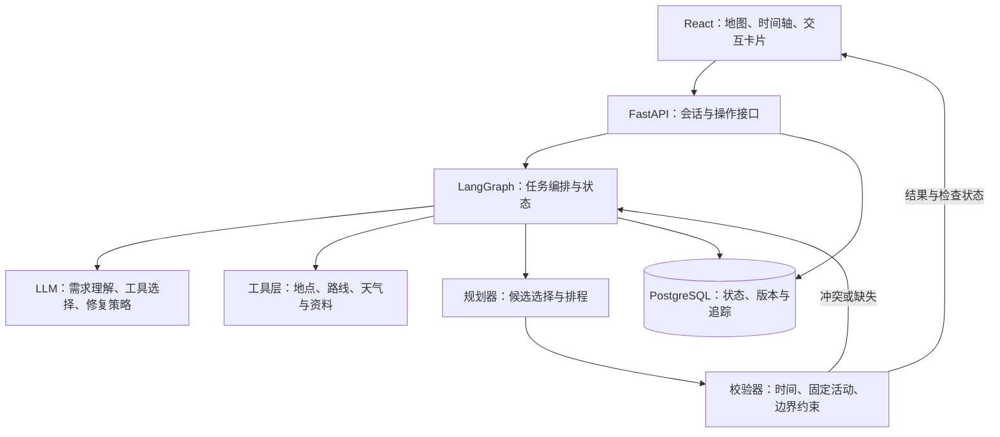

# 城市旅行 Agent 初版实施计划

编写日期：2026-10-23。本文按“做出项目初版”制定，工期与指标为计划目标。当前完成范围及验证边界见[初步实现状态](IMPLEMENTATION_STATUS.md)。

## 1. 项目目标与产品价值

**产品定位：把用户想去的地点变成可执行行程，并在出行过程中以尽量少的改动完成调整。**

目标用户是已有部分收藏、酒店和抵离安排，准备在杭州进行 1～3 天自由行、不自驾的人。优先解决三个问题：整理零散地点、发现时间与交通冲突、处理出门晚或天气变化后的安排。

项目完成后，应能演示以下完整过程：

1. 用户输入日期、酒店、抵离时间、想去的地点和偏好。
2. 系统澄清缺失条件，展示可编辑的需求确认卡。
3. 系统查询地点、路线及可用天气数据，生成地图与每日时间轴。
4. 用户锁定已预约活动，替换另一个活动；系统预览修改及影响。
5. 用户输入“晚出门 40 分钟”或“下午减少户外活动”，系统重新规划剩余安排。
6. 用户确认更新，刷新页面后继续查看；需要时恢复之前的行程版本。

验收关注完成任务和处理失败的能力，不以工具数量、Agent 数量或页面数量衡量复杂度。

## 2. 初版范围

### 2.1 必须完成（P0）

| 范围 | 初版行为 |
| --- | --- |
| 城市与天数 | 杭州，1～3 天，统一使用 Asia/Shanghai 时区 |
| 出行方式 | 步行、公共交通；交通数据无法获取时明确返回缺失 |
| 酒店与抵离 | 用户提供酒店位置、抵离站点与时间，作为行程边界 |
| 地点输入 | 手动选择、输入名称或粘贴攻略文本；同名地点需消歧 |
| 约束 | 必去地点、固定活动、每日起止时间、用户明确的硬性条件 |
| 偏好 | 地点兴趣、活动密度、休息需求、减少步行等软性目标 |
| 行程生成 | 查询事实、安排时间、检查约束、展示依据与待确认项 |
| 修改 | 锁定、替换、删除活动；延误后重新规划；预览并确认 |
| 持久化 | 需求、对话、执行状态、工具摘要、行程版本与操作记录 |
| 交互 | 移动端可用的地图、时间轴、活动卡、冲突卡和今日行程 |
| 评测 | 固定数据集、自动检查、版本对比、Badcase 记录 |

### 2.2 完成 P0 后再考虑（P1）

- 截图 OCR、更多城市、更多交通方式。
- 用户明确同意保存的跨旅行偏好，支持修改和删除。
- 更丰富的预算估算、分享链接、行程导出。
- OR-Tools 规划器与启发式规划器的对照实验。
- 接入 Langfuse 等平台，替换或补充初版结构化追踪。

### 2.3 初版边界

- 酒店检索仅在后续需要时增加；首版使用用户已确定的酒店。实时房价与房态需要对应供应商接口。
- 用户录入已订车次与预约；不实现车票余量查询、订票、支付或自动改签。
- 天气更新由生成计划或用户操作触发，不实现后台持续监控。
- 不依赖小红书账号抓取；首版接收用户粘贴的文本和地点。
- 排队时间、景区内部步行、价格等无法核实的内容标为估算或未知。
- 先支持个人本地或受控演示使用。公开多用户发布前另行补充认证、数据隔离与部署验收。

## 3. 系统设计与职责分工

### 3.1 参考架构



### 3.2 LLM 与代码的边界

| 组件 | 负责 | 输出 |
| --- | --- | --- |
| LLM | 理解用户意图、识别歧义、选择补查工具、提出修复策略、解释取舍 | 经 Schema 校验的需求补丁、工具请求、修复动作与解释 |
| 编排器 | 固定流程、按需工具循环、执行预算、超时、恢复与结束条件 | 可恢复的任务状态与事件 |
| 工具层 | 调外部 API、校验输入、归一化结果、记录来源与错误 | 结构化事实与可用性状态 |
| 规划器 | 筛选和排列地点、安排时间、插入休息、处理锁定活动 | 结构化行程候选 |
| 校验器 | 检查已知时间关系、必去项、固定安排、边界与明确限制 | 违反项、缺失项、检查覆盖情况 |
| 后端 | 版本提交、并发控制、持久化、任务查询与卡片操作 | 一致的行程状态 |

固定需要的数据由工作流直接查询，可并发执行；需要根据语义选择的数据查询暴露为 Function Calling。二者复用同一套后端服务函数。

工具成功不等于计划成功，Schema 合法不等于事实正确。硬性条件不得被模型自行放宽；无法满足时给用户提供取舍。

### 3.3 拟采用的技术栈

- 后端：Python 3.12、FastAPI、Pydantic、SQLAlchemy、Alembic。
- Agent：LangGraph；通过适配层接入支持工具调用与结构化输出的模型。
- 前端：React、TypeScript、Vite；地图优先使用高德 JS API。
- 数据库：PostgreSQL；结构化地点、状态、版本与工具记录先存同一数据库。
- 测试：pytest；前端核心交互采用 Playwright。
- 初版后台任务：单独的 worker 进程，基于数据库任务表领取任务，记录租约和心跳；重启后恢复过期任务。
- 初版追踪：结构化日志与 trace_id；预算、重试和工具耗时可查询。暂不增加 Redis、消息中间件或独立向量数据库。

首个代码里程碑锁定具体依赖版本并提交锁文件。模型、工具提供方通过配置切换。

## 4. 数据与工具设计

### 4.1 工具清单

| 工具 | 关键输入 | 必须返回的信息 |
| --- | --- | --- |
| search_places | 城市、关键词、类型或中心位置 | 地点 ID、名称、坐标、地址与候选匹配信息 |
| get_place_details | 地点 ID | 营业信息、资料来源、更新时间、缺失字段 |
| get_routes | 起终点、方式、预计出发时间 | 时间与距离估计、步行部分、可用方案、查询时间与适用限制 |
| get_weather | 区域、日期范围 | 实况或预报、覆盖日期、数据更新时间、不支持的日期 |
| lookup_place_notes | 地点 ID、待核实问题 | 整理的预约说明、室内外属性、停留时间依据与引用 |

路线接口是否支持所需出发日期与时间，在 M0 验证。提供方不支持时标注估算范围，不伪装成该时刻的实时路线。

工具统一返回以下语义，具体字段在实现时通过 Pydantic 定义：

- status：ok / partial / no_result / unavailable / invalid_input。
- data：归一化业务数据，缺失使用 null 或明确的缺失字段列表。
- provenance：提供方、查询时间、有效范围与必要引用。
- error：错误类别、是否可重试、用户能理解的说明，不含密钥。

no_result 表示成功查询后没有匹配结果；unavailable 表示接口不可用。两者不能混用。

每个任务设置模型轮次、工具次数、总时长和费用预算；具体默认值在 M0 测量后固定。仅对可重试故障做有限退避重试，超过预算返回部分结果与原因。

### 4.2 首批数据

- 整理 40～60 个杭州地点，涵盖景点、室内活动、餐饮和休息点。
- 每个地点至少记录：稳定 ID、名称、地址、坐标及坐标系、类别、室内外属性、停留时间估计、来源与采集时间。
- 营业时间、最晚入场、预约要求、票价分字段保存，未知时显式保留未知。
- 酒店位置、固定预约与抵离时间来自用户输入，不能用模型推测替代。
- 地图、天气等数据使用各自要求的坐标格式，禁止不同坐标系直接混算。
- 实时工具与固定快照采用相同接口；评测使用可再分发、已脱敏的数据及自建模拟夹具。
- 原始响应是否允许长期保存，按提供方要求处理；固定测试不依赖无限期缓存外部服务数据。

### 4.3 RAG 的位置

初版用地点 ID、标签和关键词检索整理资料，返回引用。路线、日期、营业时间和预算使用结构化查询与计算。

如果后续攻略文本规模扩大，或评测显示关键词召回不足，再增加向量检索及重排，并通过同一测试集比较效果。接入向量库不作为初版验收条件。

## 5. 状态与核心数据模型

### 5.1 上下文分层

| 层次 | 内容 | 更新规则 |
| --- | --- | --- |
| 最近对话 | 当前表达、追问、地点指代 | 保留必要轮次，长对话摘要保留来源和当前条件 |
| 旅行需求 | 日期、抵离、酒店、必去项、硬约束、软偏好 | 经字段校验的补丁更新，记录变更来源 |
| 任务状态 | 阶段、待查项、冲突、候选、检查点 | 编排器更新，支持恢复 |
| 证据 | 地点信息、路线结果、天气与资料引用 | 按需载入，标记更新时间和有效范围 |
| 行程版本 | 日程、锁定活动、检查结果、生成依据 | 已确认版本不可原地覆盖 |

首版不自动建立跨旅行记忆。“本次晚起”只影响本次需求；长期偏好在 P1 单独实现。

### 5.2 主要实体

- Trip：旅行 ID、时区、日期、需求版本、当前确认行程版本。
- Constraint：类型、值、硬或软、适用日期、来源、确认状态。
- Place / PlaceEvidence：地点元数据与字段级依据。
- Activity：活动稳定 ID、地点、起止时间、停留时间、锁定属性、是否完成。
- RouteLeg：相邻活动之间的交通方案、估计耗时、查询时间与有效范围。
- ItineraryVersion：不可变行程快照、父版本、修改摘要、校验报告。
- Proposal：基于某个确认版本生成的待确认方案，包含变更明细。
- Run / ToolCall：任务阶段、执行租约、预算、工具状态、耗时与检查点。
- Message / Action：用户表达、卡片操作、幂等键和应用结果。

只保存可观察的执行信息、输入输出和决策摘要，不依赖模型隐藏推理。

### 5.3 状态语义

- FEASIBLE：在当前模型及已知数据下通过检查；仍展示估算和检查覆盖情况。
- NEEDS_CONFIRMATION：关键事实缺失或需要用户确认，不能显示为已全面核实。
- CONFLICT：存在可指出的直接约束矛盾，例如固定活动时间重叠。
- NO_SOLUTION_WITHIN_LIMIT：当前候选、搜索和调用预算内未找到方案，不声称数学上无解。
- FAILED / CANCELLED：执行失败或被用户取消，保留恢复信息。

## 6. 规划与重新规划

### 6.1 分阶段实现

1. 最小链路：LLM 输出结构化候选日程，使用真实工具结果和独立代码校验，建立基线。
2. 初版规划器：候选按区域和兴趣筛选，以固定活动切分时间段，采用插入、替换和顺序交换生成日程。
3. 评测后决定：引入 OR-Tools 时间窗及可选访问点，比较可行率、偏好、耗时和复杂度。

算法规划器不要求 LLM 参与每次计算。LLM 处理语义和修复策略，算法负责数值排程，校验器独立于两者。

### 6.2 必须检查的关系

- 下一站到达时间 >= 上一站离开时间 + 交通估计 + 适用缓冲。
- 固定活动的到达、结束及预留时间符合用户确认的要求。
- 活动安排满足已知营业与最晚入场规则；未知规则进入待确认列表。
- 必去地点保留，已完成活动固定，锁定活动按锁定属性处理。
- 日程满足每日起止、酒店与抵离边界。
- 用餐、休息和停留时间有明确配置及来源。
- 明确步行上限时，区分路途步行与景区内部估算；缺失部分不能当作零。
- 若预算纳入约束，先确定人数、费用范围和已支付项；估算与已确认支出分开。

路线时间随出发时间变化。首版可用时间段近似，排程后复查关键衔接；更新后再次校验，并限制修复次数。

### 6.3 控制搜索与查询成本

- 从有限候选开始，先按区域、明确条件和主题缩小范围。
- 对有希望使用的相邻地点查询路线，避免默认计算全部地点对。
- 在提供方允许的范围内复用路线结果，区分方向、交通方式、出发时间段和数据新鲜度。
- 记录候选数、查询数、重试数和耗时；预算耗尽时保留可解释的部分结果。
- 比较软目标前先满足硬约束，避免用偏好分数抵消固定预约冲突。

### 6.4 增量重规划

1. 读取用户提交的基准行程版本和变更，检测是否过期。
2. 固定已完成活动、当前时间位置和用户锁定内容。
3. 找到受影响活动及后续时间、路线和跨日依赖。
4. 依次尝试有限的调整：剩余空档、顺序、可选活动、替代地点。
5. 重新查询必要路线，校验整个受影响范围和旅行级约束。
6. 生成 Proposal，展示活动增删、时间变化、交通变化和未满足条件。
7. 用户确认后，以事务提交新版本；重复请求只应用一次。
8. 如果基准版本已经变化，返回版本冲突，要求基于最新状态重新生成。

优化目标包含“减少不必要修改”，但不能为保留旧安排而违反硬约束。恢复历史版本也创建新版本，保留变更记录。

## 7. 接口与交互契约

以下为首版拟定接口，正式实现时以 OpenAPI 为准。

| 接口 | 用途 |
| --- | --- |
| POST /api/trips | 创建旅行和初始需求 |
| GET /api/trips/{trip_id} | 加载需求、当前版本和执行状态 |
| POST /api/trips/{trip_id}/messages | 对话理解与澄清；返回任务 ID |
| PATCH /api/trips/{trip_id}/requirements | 提交结构化需求补丁，携带需求版本 |
| POST /api/trips/{trip_id}/plan-runs | 生成计划，返回任务 ID |
| GET /api/runs/{run_id} | 查询任务进度、部分结果或失败 |
| GET /api/runs/{run_id}/events | SSE 进度事件，可按游标恢复 |
| POST /api/trips/{trip_id}/proposals | 根据锁定、替换、延误等操作生成调整建议 |
| POST /api/trips/{trip_id}/proposals/{proposal_id}/apply | 确认新版本，携带基准版本和幂等键 |
| GET /api/trips/{trip_id}/versions | 查看版本历史 |
| POST /api/trips/{trip_id}/versions/{version_id}/restore | 基于历史快照创建新的确认版本 |

前端接收经过校验的事件，例如 run_started、tool_finished、conflict_detected、proposal_ready、run_failed、run_completed。事件包含 run_id、event_id、类型与业务负载。

不直接渲染模型尚未完成或尚未校验的 JSON。对话和卡片操作进入同一套需求及行程状态；活动卡片始终使用稳定 ID。

必须实现六类组件：需求确认卡、地图与时间轴、活动卡、冲突卡、修改对比卡、今日行程页。刷新或网络重连后，从服务端恢复状态。

## 8. 开发里程碑

按单人每周约 20～25 小时估算，共 6～8 周。工期随基础和接口可用性调整；每个里程碑通过验收后再扩大范围。

| 里程碑 | 时间参考 | 任务 | 交付与验收 |
| --- | --- | --- | --- |
| M0：验证依赖和数据 | 第 1 周前半 | 验证模型工具调用、地图展示、地点与路线查询、天气范围；整理 10 个地点和 10 条任务 | 小脚本可查真实数据；记录账号权限、耗时、错误与数据缺口；固定一个完整演示需求 |
| M1：最小应用链路 | 第 1 周后半～第 2 周 | 建立前后端和数据库；需求录入；工具适配；生成结构化行程；基础校验；地图时间轴 | 一个单日任务从输入到保存可运行；刷新可恢复；工具错误有明确提示；记录 LLM 日程基线 |
| M2：可靠规划 | 第 3～4 周 | 数据扩至 40～60 地点；硬软约束；启发式规划器；1～3 天边界；冲突与未知状态 | 固定活动、营业时间和抵离边界有独立检查；可行、冲突、缺失和搜索预算耗尽能区分；运行首轮对照评测 |
| M3：调整与途中使用 | 第 5 周 | 锁定/替换/删除；延误重规划；差异预览；版本确认恢复；今日行程与导航衔接 | 固定预约不会被悄悄移动；重复操作不重复提交；过期版本被拒绝；移动端可完成调整流程 |
| M4：恢复与评测 | 第 6 周 | 任务检查点、worker 恢复、工具故障注入、调用预算、完整评测集 | 模拟重启可恢复任务且不重复提交版本；输出各基线结果、成本和 Badcase；关键回归进入 CI |
| M5：真实试用与交付 | 第 7～8 周 | 找 5～10 名有需求的用户试用；修复主要问题；整理部署说明、演示和复盘 | 形成匿名试用记录、至少一轮改进对比、可重复演示与真实指标；发布本地初版标签 |

每周只保留一个可运行主流程。优先完成闭环，其次提升可靠性，再扩大城市和功能。

### M0 可直接领取的任务

- [x] 建立 backend / frontend / evals / data / scripts 目录，并补充本地启动说明。
- [ ] 验证地图 Key 的前端与服务端用途，密钥通过环境变量配置。
- [ ] 验证一次模型工具调用与一次结构化输出，记录失败行为。
- [ ] 验证 3 组步行/公交路线、同名地点搜索、日期范围内外的天气查询。
- [ ] 整理 10 个有来源的地点，至少包含一个室内替代点与一个时间限制案例。
- [x] 固定 10 条冒烟任务，包括可行、冲突、信息缺失和工具故障。
- [x] 定义需求、工具结果、行程、校验报告的 Pydantic Schema。
- [ ] 根据实际查询耗时和费用设置第一版任务预算。

## 9. 评测、测试与验收

### 9.1 数据集

逐步形成约 100 条固定任务：70 条开发与回归任务，30 条保留测试任务。测试集在方案冻结后运行；失败样本进入下一版本开发集时，需更新保留集并记录版本。

覆盖普通单日与多日规划、地点歧义、固定预约、抵离限制、条件矛盾、天气信息缺失、临时延误、锁定活动、路线故障、重复操作与版本冲突。

每条样本包含：任务 ID、用户需求、历史状态、工具夹具、必须满足条件、预期状态、可接受的调整集合、数据版本。允许多种正确日程，不要求逐字匹配参考答案。

### 9.2 对照实验

- A：直接 Prompt 生成行程，作为起始基线。
- B：固定工具查询 + LLM 日程 + 校验，作为有事实依据的基线。
- C：工具 + 启发式规划 + 校验 + 有限 Agent 修复循环。
- 可选 D：用 OR-Tools 替换启发式规划器，其余条件保持一致。

比较时明确数据可见范围。B/C 使用相同模型、工具夹具和预算，并对比相同预算下的结果；A 缺少工具的影响单独解释。对主要方案做“去掉修复循环”和“去掉减少修改目标”的消融实验。

模型与 Prompt 记录版本；固定数据上重复运行以观察波动。真实在线工具另做冒烟测试，不混入固定数据性能结论。

### 9.3 指标与初版目标

下列数值是初始验收目标，不是已有成果。M0 检查任务难度，调整时保留原因。

| 指标 | 计算方式与目标 |
| --- | --- |
| 明确硬约束检查 | 所有宣称 FEASIBLE 的夹具结果必须通过独立校验；发现违反立即阻止提交 |
| 可行任务完成率 | 在明确可行、有足够数据的保留任务上，以满足约束并完成提交为成功，目标 >= 80%，同时报告分母与拒答率 |
| 状态正确性 | 明确冲突、未知事实、工具不可用和搜索预算耗尽分别统计，不能靠一律拒绝提高安全通过率 |
| 信息覆盖 | 每个计划展示关键检查项的已核实、估算、缺失情况；未知不能计入已核实 |
| 增量修改 | 报告未受影响活动的保留比例、改动数量和硬约束结果；与全量重排比较 |
| 执行成本 | 报告每任务模型 token、工具调用数、失败重试、总耗时及样本 P50/P95；先测量再确定体验预算 |
| 用户价值 | 记录完成计划耗时、手动修改次数、途中使用情况和具体错误；试用样本量与限制一并说明 |

### 9.4 必要测试

- 时间、日期边界、营业时间窗口、抵离缓冲、硬软约束与未知数据处理。
- 工具超时、限流、空结果、部分字段缺失和过期数据。
- 固定活动与已完成活动在重规划中的保留规则。
- 并发修改、重复 apply、旧版本操作和恢复历史版本。
- worker 重启、任务领取租约过期、事件重连与最终结果一致性。
- 三条端到端流程：新建并保存行程、延误后调整、冲突后选择取舍。

不依赖真实接口运行每次 CI；CI 使用固定夹具和小规模回归，真实接口检查手动触发或在发布前执行。

## 10. 建议目录结构

以下为目标目录结构；实际已落地结构及后续工作见初步实现状态文档。

```text
backend/
  app/
    api/                  # HTTP 与 SSE
    agent/                # 图、状态、Prompt 与修复策略
    tools/                # 地图、天气、资料适配
    planner/              # 初版启发式规划器
    validation/           # 独立约束校验
    models/               # 业务与持久化模型
    services/             # 旅行、版本、任务服务
    worker/               # 任务领取、心跳与恢复
  migrations/
  tests/
frontend/
  src/
    components/           # 卡片与通用组件
    features/             # 旅行、地图、版本与今日行程
    api/                  # 类型化请求与事件
  e2e/
data/
  curated/                # 有来源、经审核的地点资料
evals/
  datasets/               # 开发与保留任务
  fixtures/               # 可再分发的固定工具数据
  runners/                # 基线与实验入口
  reports/                # 经检查的汇总结果
docs/
  IMPLEMENTATION_PLAN.md
  decisions/              # 关键设计取舍
  badcases/               # 现象、原因、修复与回归任务
scripts/                  # 初始化、冒烟与演示脚本
```

## 11. 初版完成清单

- [ ] 新环境按 README 能完成配置、迁移、导入数据并启动。
- [ ] 一条真实工具链路和一条离线演示链路均可运行。
- [ ] 用户能创建 1～3 天行程、识别待确认信息、锁定活动并完成调整。
- [ ] 地图、时间轴与服务端确认版本一致，移动端可用。
- [ ] 延误重规划能保留固定预约，并展示改动及后续影响。
- [ ] 工具失败、条件冲突和数据缺失均有明确、可恢复的处理。
- [ ] 固定数据评测可重复运行，结果注明配置、数据版本与样本量。
- [ ] 整理至少 5 个有代表性的 Badcase，其中包括工具失败和重规划问题。
- [ ] 形成匿名用户试用记录、演示视频、架构说明与设计取舍。
- [ ] 对已完成代码执行适当检查后，创建 v0.1.0 标签；简历指标只填写实测结果。

## 12. 参考资料

下列资料用于设计参考；实施时确认当前 API、权限与版本，项目宣传中的性能不作为本项目结果。

- [高德地点搜索](https://lbs.amap.com/api/webservice/guide/api/search/)
- [高德路径规划](https://lbs.amap.com/api/webservice/guide/api/direction)
- [高德天气查询](https://lbs.amap.com/api/webservice/guide/api/weatherinfo)
- [高德路径规划 URI](https://lbs.amap.com/api/uri-api/guide/travel/route)
- [LangChain Tools：工具定义、输入与输出](https://docs.langchain.com/oss/python/langchain/tools)
- [LangGraph Persistence：检查点与长期存储](https://docs.langchain.com/oss/python/langgraph/persistence)
- [OR-Tools 时间窗路线规划](https://developers.google.com/optimization/routing/vrptw)
- [OR-Tools 可选访问点与惩罚](https://developers.google.com/optimization/routing/penalties)
- [CopilotKit Generative UI 示例](https://github.com/CopilotKit/generative-ui)
- [Langfuse：追踪与评测](https://github.com/langfuse/langfuse)
- [Promptfoo：自动评测与对照实验](https://github.com/promptfoo/promptfoo)
