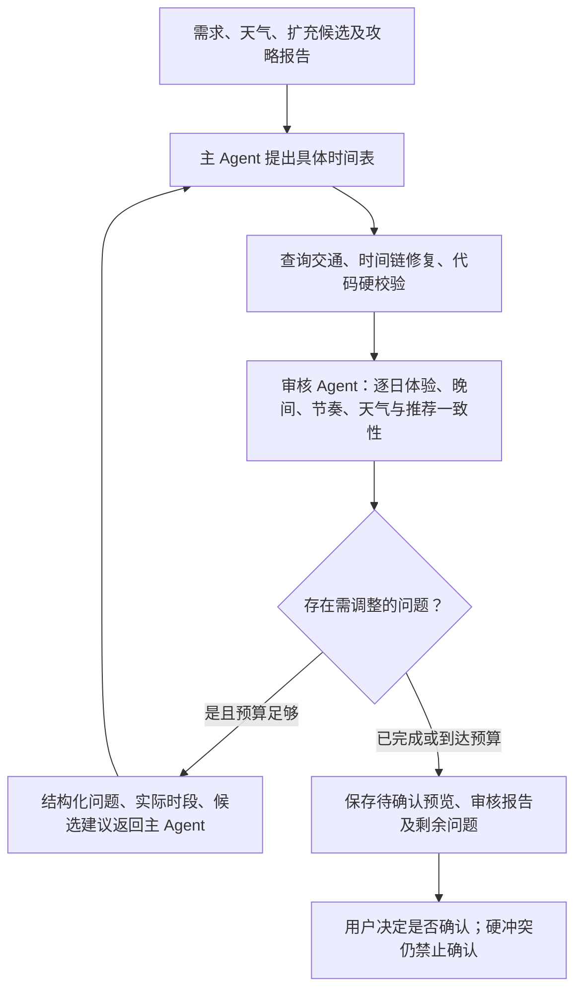

# 独立行程体验审核

> 历史实施记录：其中晚间优先、固定阈值和地点唯一等策略已调整，当前行为以[约束政策](CONSTRAINT_POLICY.md)为准。

2026-10-27。

最近一份深圳草案两天均在 18:00 后缺少具体安排。旧流程已发现低占用与长留白，但主模型第二次返回未通过时间表格式校验，系统保留了旧预览。因此，“触发过复核”不等于“已修复”。本轮保留失败原因，增加独立上下文的体验审核与可追溯反馈。

## 职责与替换范围

审核 Agent 复用现有模型配置，使用独立的一次 Chat Completion 请求，不共享主 Agent 的对话历史。输入包括需求、逐日真实可用窗口、程序修复后的活动/休息/交通、候选名称与坐标及估算属性、实际日期天气、推荐理由和室内外模型判断。程序检查作为信号补充。不传入 API 配置、完整网页或其他 Agent 的原始聊天记录。

审核成功时，用模型逐日体验判断替代 `schedule_review.py` 中固定占用比例、留白分钟数、天气与推荐表述等启发式结论；旧规则只作为审核信号与失败兜底。模型可判断必要休息合理，不要求把每天塞满；也不能用笼统自由时间自动解释整晚留白。即使没勾夜景，多探索且允许至 23:00 也应比较晚间街区、文化等候选。每一天独立判断，不能用第一天有夜景来覆盖第二天缺失。

继续由代码独立校验：地点与日期合法性、活动顺序与交通衔接、用餐/休息重叠、可用时段、已知营业时间、必去/排除/指定日期、固定预约/用户锁定、酒店与抵离边界。审核模型无权豁免这些错误。模型判断不是已核实的营业、预约、日落、步行或天气事实。

## 报告与闭环

`PlanningDecision.quality_review` 包含状态、摘要、逐日 `days`、结构化 `issues` 与 `input_digest`。状态区分未请求、通过、建议修改、不可用。问题包含日期、类别、实际时段/地点依据、可执行建议、所选地点 ID 和可比较的备选 ID。报告必须覆盖全部日期；不存在的地点、指向其他日期的活动、重复/遗漏日期、没有对应修改建议的不足判断会被拒绝。

首次生成最多两份草案，每份最多一次独立审核；有问题时主 Agent 有一次修改机会，修改后再次审核。自然语言调整沿用最多三轮协调预算，对具有具体模型时间表的草案审核，保持冻结日期和用户允许范围；更差的硬冲突方案不替代较好预览。酒店选择改变路线后刷新体验审核，但不额外启动无限重规划。

审核成功后，比例和空白阈值不直接决定体验好坏。审核失败/超时/无预算时明确降级，保留程序信号及原预览，不伪装审核通过。剩余体验问题以警告供用户取舍；硬错误继续阻止保存。新增模型调用会增加成本和延迟，每次最多 15 秒，从现有总时间预算扣除，首轮为主 Agent 修改预留时间。

报告绑定需求、实际时刻、交通、天气、推荐和所选地点属性的摘要。计划改变后旧报告失效；完整目录快照仅增加未选候选不会使同一时间表的审核失效。报告随预览和确认版本保存，`agent_tasks` 增加 `reviewer` 角色记录输入/输出及完成或降级状态，无需数据库迁移。

页面“行程检查”展示独立体验审核摘要，可展开逐日依据。审核仍有建议、审核不可用、硬冲突分别呈现；“体验未发现问题”不等于所有出行事实已确认。旧行程不补造审核历史，重新生成或调整后才执行审核。

## 验证与限制

新增回归覆盖：无夜景兴趣但整晚留白、逐日覆盖、未知/跨日地点引用拒绝、有依据的休息不被比例规则强迫填满、审核无法豁免硬冲突、失败脱敏与时间预算、旧审核失效、完整目录快照兼容、自然语言调整保留冻结日、预览/确认持久化。浏览器覆盖报告展开、刷新、手机宽度、体验通过仍显示硬冲突和审核失败提示。

最终检查：293 项后端测试、64 条桌面/手机浏览器回归、Ruff 检查与格式、前端格式与生产构建通过。

真实模型只读审核最近深圳草案约 7.8 秒，识别了两天的晚间缺失和节奏问题。一次主模型修改中第一天增加了晚间活动，第二天仍未补齐；后续审核结果未通过校验。另一次独立请求未取得可用规划。验证在内存副本与被 Git 忽略的 `artifacts/` 进行，没有改写用户库或 API 配置。这说明审核提高可见性和反馈质量，仍不能保证同一模型在有限重试内解决所有旅行需求，也不能证明晚间场所实际开放。
