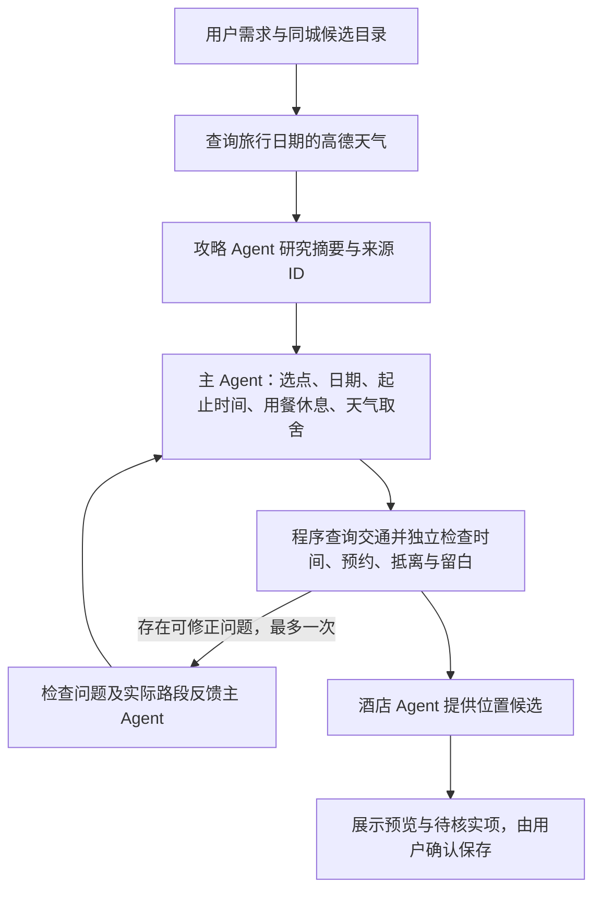

# 具体时间表与天气参与主规划

> 历史实施记录：其中晚间优先、固定阈值和地点唯一等策略已调整，当前行为以[约束政策](CONSTRAINT_POLICY.md)为准。

日期：2026-10-26。

同日后续补充：夜景意图落实、模型室内外判断、午餐局部重排及检查分组见 [夜景意图与局部修复](NIGHT_INTENT_AND_LOCAL_REPAIR.md)。下文保留首轮设计和当时验证记录；普通活动的新可调窗口在后续设计中说明。

原实现先由主模型选择地点和分天，再查询天气、从每日开始时间顺排活动。模型理由中的“傍晚看夜景”没有进入结构化时间约束，导致深圳样例虽允许到 23:00，第一天仍在 12:22 结束。本轮将时间安排变成主模型的正式输出，天气提前进入输入。



## 输入

- 基本需求：目的地、当地时区、日期和天数、探索强度、主题、同行人、步行偏好及补充描述。
- 硬条件：必去地点、指定日期、固定预约、每日可用窗口、抵离地点与缓冲；已有住宿选择在修改时传入。
- 候选目录：稳定 ID、名称、坐标系与坐标、类型、估算停留时长及范围、已知营业时间、室内外状态与待核实提示。
- 天气：按实际旅行日期匹配的白天/夜间天气、温度、风力、预报发布时间、查询时间、Provider 和来源；未覆盖日期明确为 unknown。
- 攻略：独立攻略 Agent 的结构化短结论与可解析来源 ID，完整网页文本不混入主模型上下文。
- 复核时另附上一版具体时间表、已查询路段及检查问题。

天气接口沿用高德 Web 服务 `weatherInfo?extensions=all`。官方返回字段和预报发布时间说明见 [高德天气文档](https://lbs.amap.com/api/webservice/guide/api/weatherinfo)。实际覆盖日期以接口为准，不硬编码扩展到旅行全程，不把逐日预报推成小时降雨，也不据此声称景点开放。

每次首次规划只查询一次天气，后续排程和本轮复核复用同一快照，避免重复高德调用。修改已有行程使用保存的天气快照并保留发布时间；尚未提供出发前自动刷新天气的功能。

## 输出及落地

模型输出 `place_ids`（比较候选）、`daily_schedule`（真正安排）及逐地点推荐依据。每个日程包含：

`place_ids` 是可选的候选顺序索引；省略时从具体时间表派生，不要求模型重复输出同一信息。

```json
{
  "day": 1,
  "activities": [
    {"place_id": "museum_id", "start": "10:00", "end": "11:30", "reason": "白天预报有雨，先比较文化活动，实际室内条件待核实"},
    {"place_id": "viewpoint_id", "start": "19:00", "end": "20:00", "reason": "落实晚间观景偏好，开放与现场天气需核实"}
  ],
  "breaks": [{"start": "12:00", "end": "13:00", "kind": "meal", "reason": "同区午餐"}],
  "weather_note": "说明实际日期的预报与选点、时段取舍；没有预报时明确未知"
}
```

时间为目的地当地 HH:MM。程序保留模型提出的时段，不改成早上顺排；普通活动可按查询路段在 30 分钟内顺延并逐项记录，停留时长不变，不超出已知营业及当天边界。固定预约和用户锁定活动不移动。交通接不上、预约移动、用餐与活动重叠、用餐和交通抢占同一空档、超出抵离窗口等均形成阻断错误，不能确认保存。明确时间表不再受旧规则每天 3/4 个活动的上限限制，输出仍有每日至多 12 个活动的资源边界。

`breaks` 为用餐、休息或自由安排，不是预订餐厅，也不代表已经规划交通。不能把跨区交通耗时同时记为休息占满空档。页面展示独立的“天气安排依据”和用餐休息时段，并展示白天/夜晚天气与预报发布时间。

当模型把休息占满转场空档时，程序可按查询到的路段及缓冲缩短软休息块，并以 `break_adjusted` 明确记录前后时间；固定预约不移动，普通活动的微调单独记录。用餐至少保留 30 分钟，其他休息至少 15 分钟，仍不足则保留阻断错误，不以牺牲预约或零用餐时间强行通过。

`daily_schedule` 是实际安排的主数据。兼容语义一致的旧 `day_groups` 对象表示，只归一化表示，不修改模型地点与分天；两者不一致时拒绝。结构错误可在现有模型请求和时间预算内纠正一次，不新增地图搜索。旧服务仅返回地点时仍可兼容，但页面明确标注程序顺排，不能声称已实现模型时段意图。

## 有界反馈

首次规划最多比较初稿及一次修改稿；硬错误少的方案优先，其次比较可修正的时间/天气偏好问题。修改失败或引入更多硬错误时保留原预览及问题，不覆盖用户已保存行程。

“多探索”在较长可用日期中出现扣除转场后至少三小时、未说明用途的空白，会产生反馈；夜景偏好且晚间可用却没有晚间体验也会反馈。这些属于偏好检查，不机械要求填满到 23:00。已说明的合理休息和自由时间允许保留。

为避免把整个下午写成“自由安排”规避检查，活动及交通占可用时段不足 45% 时也提供偏好反馈。该比例是可调整的启发式，不是旅行准确率或强制占满要求。

雨雪等预报与已知室外活动冲突时提供比较避雨方案的反馈。真实 POI 的室内外为 unknown 时只提示待核实，不把“博物馆”分类或旧布尔字段升级为室内事实，也不因此无限复核。天气取舍不替代官方营业、预约、安全公告或实地确认。

自然语言跨日重规划也可返回受影响日期的具体时间表；已采用时间表的行程要求继续返回时段。冻结日期保留原活动、用餐休息及说明，锁定与预约仍接受独立检查。仅延迟出发时相应移动休息段并复核冲突。修改过程中不自动刷新天气。

## 状态与验证

时间表、休息段、天气快照、模型取舍和复核轮次保存于原有 SQLite JSON 快照，用户确认后才成为新版本；本轮不需要新增表或改写旧确认行程。主 Agent 任务记录保存天气输入摘要和两次时间表尝试，不保存 Key 或完整模型聊天。

本轮没有实现首次规划的自主联网补查，也没有接入新的营业/预约核验 Agent。候选仍来自原有查询与已保存目录，酒店仍只提供位置参考。

主要回归位于 `backend/tests/test_timed_weather_planning.py`；页面回归位于 `frontend/e2e/recommendation-basis.spec.ts`。在线定向回放只在内存使用深圳旧需求与候选，关闭攻略及酒店研究以集中验证天气、主模型和交通，不写入用户数据库；不能视为完整旅游事实验证。

最终验证：251 项后端测试、54 条桌面/手机浏览器回归、Ruff、前端格式与生产构建通过；原 10 条冒烟和 30 条合成开发样例符合预期。后端增加 30 项定向测试，包含时段保留、JSON 归一化、格式纠正、真实日期天气边界、休息与交通、30 分钟微调上限、固定预约保护、受影响日期重规划、天气和时间表确认持久化。

深圳定向验证先采集真实模型、逐日天气返回及一次真实模型复核，再在最终代码中回放这些返回并查询高德实际路段，无额外模型调用。采用一次有界复核后的安排为每天 4/5 个活动，均于 21:30 结束，存在晚间体验，无阻断错误和本轮密度/留白警告。普通活动因交通顺延约 2 分钟，休息调整有明确记录。最终结果仍为 NEEDS_CONFIRMATION：营业、预约、真实室内外属性、未选住宿等未核实，不能解释为已验证可直接出行。

完整回放数据在被忽略的 `artifacts/shenzhen-timed-weather-final.json`。页面使用该回放数据在独立浏览器上下文预览，桌面与 390 像素宽手机视口无横向溢出。服务重启前后逐表摘要一致，开发验证未改写用户已保存行程。
